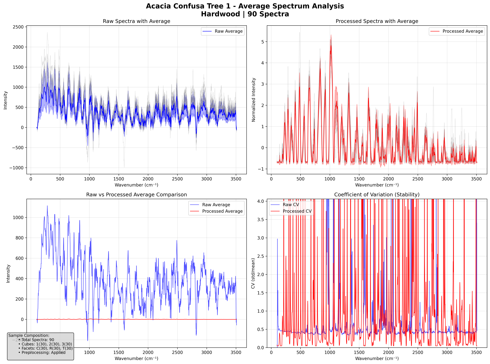
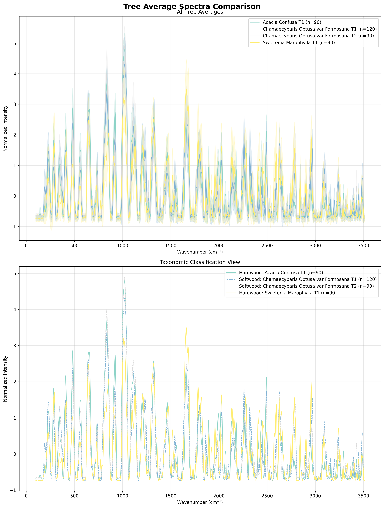

# Guide
run this for dataset organization:  
```bash
python src/complete_dataset_organization_fixed.py
```

run this for CLI prediction:  
```bash
python predict.py "dataset/organized/test/Swietenia_Marophylla/24mW-20250926-Swietenia_Marophylla-2-1-C-9.txt" 
```

run this for streamlit app:  
```bash
streamlit run app.py
```

